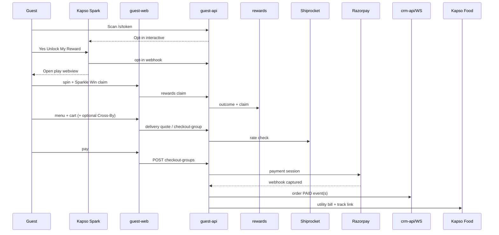
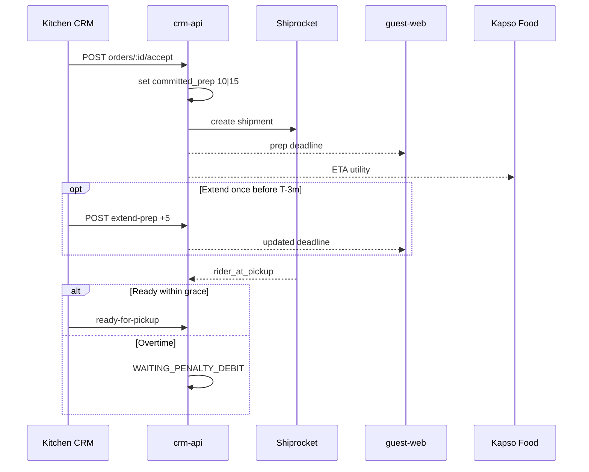
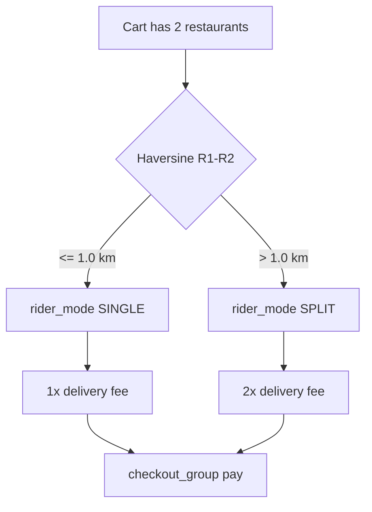
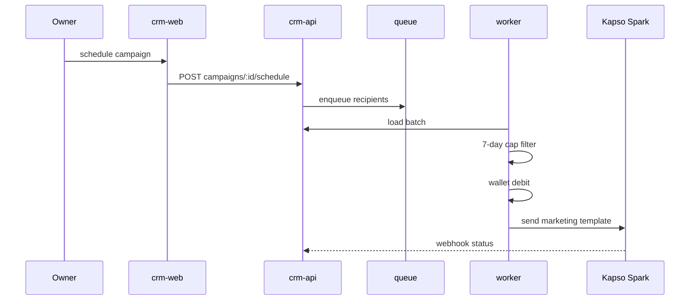
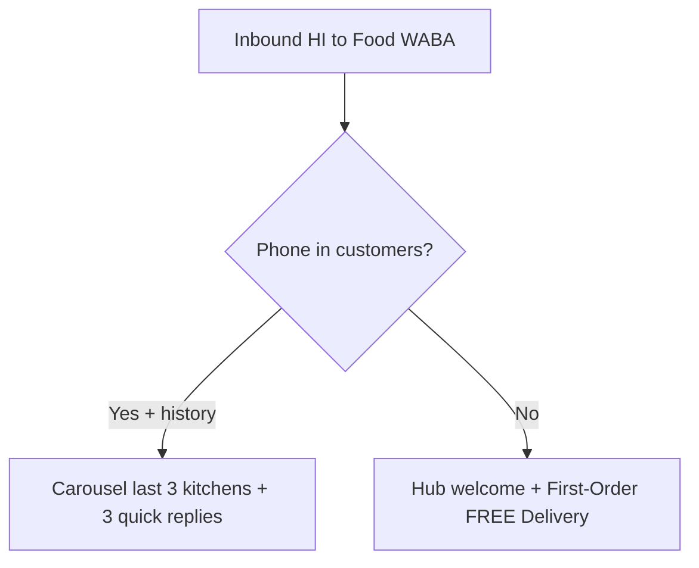

# D'aMigo's — Flow Diagrams (v2.0)

## Scan → Spark opt-in → game → paid order

## Kitchen Accept → timer → rider → penalty

## Cross-By 1 km rider split

## CRM campaign send (Spark)

## D'aMigo Food Smart HI

