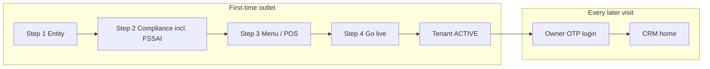

# Restaurant onboarding lifecycle (C-01)

## What we built today

`/start` (Stitch `crm_1_get_started_onboarding_login`) is a **combined** screen:

| Panel | Purpose | Persistence today |
|-------|---------|-------------------|
| Left — Steps 1–4 | New outlet **self-serve signup** | Step 1: entity + **fulfillment mode/radius** dropdowns; steps 2–4 wizard; submit is pilot stub |
| Right — Owner login | Existing **staff OTP** | Step 1 only, or full page via **Owner login** link; **hidden** while application is pending review |

## Intended product rule: fill once, do not repeat

Per PRD **C-01.01 → C-01.03**:

1. **New brand / new legal entity** completes onboarding **once** (`POST /v1/onboarding/applications` → ops or auto **ACTIVE**).
2. After `onboarding_status = complete` (and tenant **ACTIVE**), owners use **login only** — not the full wizard.
3. **Returning owners** should see **login-only** on `/start` (or redirect to `/` if session valid).
4. **Legal/compliance edits** (FSSAI, billing email, zone) move to **Settings → Brand / Compliance**, not the public wizard.

## Implementation checklist (P1)

| Item | API / UI | Status |
|------|----------|--------|
| Persist application | `POST /v1/onboarding/applications` | ⬜ |
| FSSAI verify | `POST /v1/onboarding/fssai/verify` | 🟡 stub + provider hook |
| Onboarding status on session | `GET /v1/onboarding/status` (staff) | 🟡 |
| Hide wizard when complete | `/start` reads status | 🟡 partial (login redirect) |
| Guest menu footer FSSAI | show when verified number stored | ⬜ |

See [FSSAI-VERIFICATION.md](./FSSAI-VERIFICATION.md) for license authenticity.
